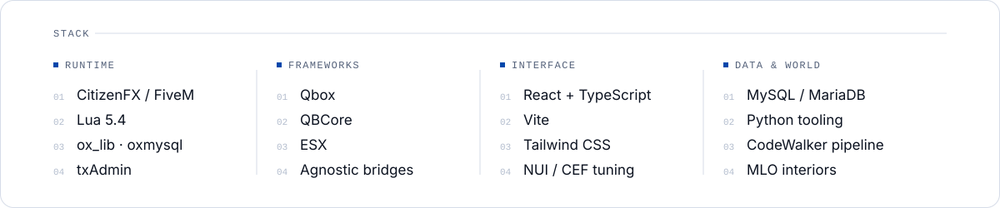

<picture>
  <source media="(prefers-color-scheme: dark)" srcset="assets/header-dark.svg">
  
</picture>

 

Lua on the server, TypeScript in front. I build the gameplay systems and in-game interfaces that players use every session without thinking about them.

| | |
|:--|:--|
| **Framework-agnostic** | One bridge layer with Qbox, QBCore or ESX underneath. |
| **Server-authoritative** | Validation, rate limits and persistence come before polish. |
| **Real front-ends** | React and Vite, tuned around CEF's quirks. No templates. |
| **Clean resources** | Typed config, no dead code, readable diffs. |

<picture>
  <source media="(prefers-color-scheme: dark)" srcset="assets/stack-dark.svg">
  
</picture>

<picture>
  <source media="(prefers-color-scheme: dark)" srcset="assets/activity-dark.svg">
  
</picture>
