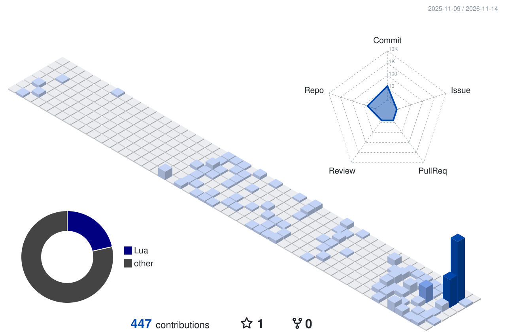

### Ocular

FiveM resource developer. I build the gameplay systems that run on the server in Lua, and the in-game interfaces on top of them in React and TypeScript.

I care about code that holds up on a live server: the server decides, the client only asks, and every interface feels built for the game rather than dropped into it.

**What I work on**

- Server-authoritative gameplay systems for Qbox, QBCore and ESX, behind one framework bridge
- NUI interfaces with React, Vite, Tailwind and Mantine, tuned for FiveM's CEF
- Tooling for security and code quality in FiveM resources

**Stack**

 

<picture>
  <source media="(prefers-color-scheme: dark)" srcset="./profile-3d-contrib/cobalt-dark.svg">
  
</picture>

Public activity only, rebuilt daily.
